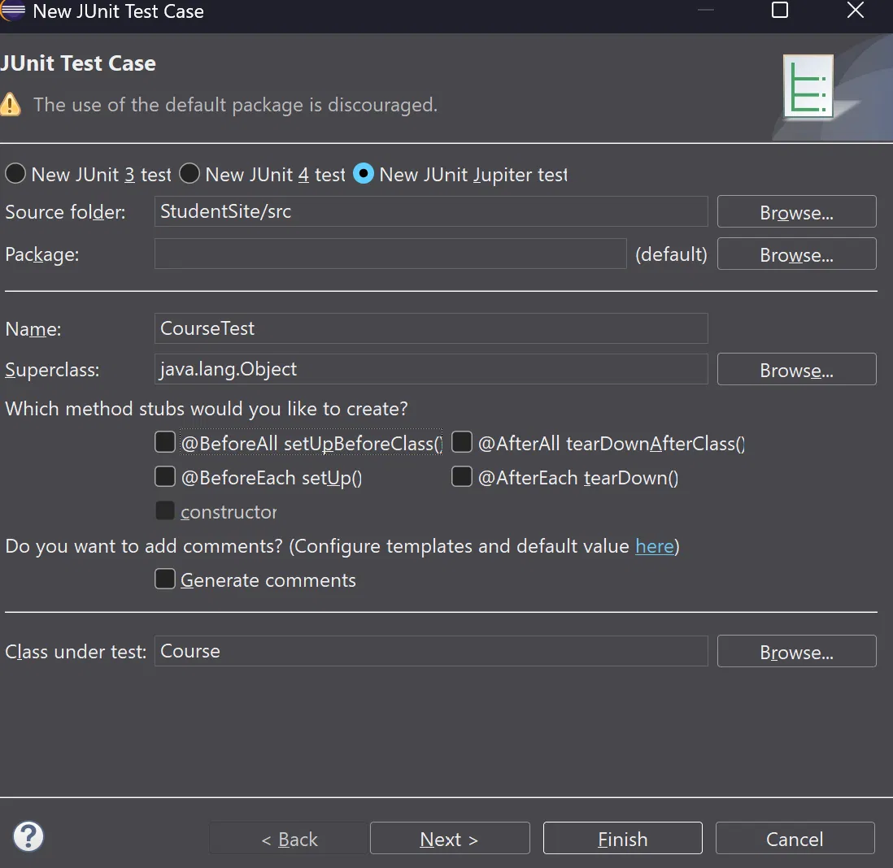

# software-fundamentals-g058-a4

Download the folder and run it in the eclipse IDE via creating your Java environment while setting up the JUnit5 environment as well.

We ticked the @BeforeEach setUp() option
This method just requires you to setup the default Test file and then copypaste the code which also works.